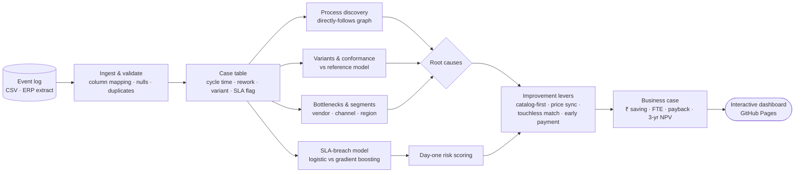

# Process Intelligence & Proof-of-Value Prototyping Platform

**Live dashboard → https://21cabbagee.github.io/process-intelligence-pov/**

A Python toolkit that takes a raw business-process event log and produces, in one run, the four things a process-improvement proof-of-value needs:

1. **What actually happens.** A discovered process map, variants and conformance against the intended process.
2. **Why it's slow.** Bottleneck transitions, rework loops and segment-level root causes (vendor, channel, region, category).
3. **Which cases will be late.** A scikit-learn model that flags requisitions likely to breach SLA on the day they're raised.
4. **What fixing it is worth.** A lever-by-lever business case (hours, FTE, INR saving, payback, 3-year NPV) driven by rates measured from the log.

The results are exported to JSON and rendered as an interactive dashboard on GitHub Pages, with live business-case sliders for stakeholder workshops.

`Python` · `pandas` · `NumPy` · `scikit-learn` · `Chart.js` · `Process mining` · `Data engineering`

## Flow



## Demo dataset

`pov_platform/generator.py` produces a representative procure-to-pay log of 2,400 cases (about 23,000 events, Jan to Sep 2026) with the inefficiencies typically found in P2P assessments: slow manual-channel approvals, vendor-specific price mismatches, PO changes, invoice-before-goods exceptions, second-level approvals above ₹5 L, and a weekly payment run. Because these patterns are known in advance, the tests check that the mining stage recovers them (for example, that manual cases are slower and Apex Components is a top mismatch vendor). A 300-case sample of the log is in `data/p2p_event_log_sample.csv`.

Current run on the demo log:

| Metric | Value |
|---|---|
| Median / P90 cycle time | 17.1 / 25.3 days |
| SLA (21 days) breach rate | 30% |
| Happy-path conformance | 63% |
| SLA-breach model | Gradient boosting, ROC-AUC 0.82; top-20% risk tier catches 47% of breaches |
| Modelled business case (25k requisitions/yr) | ≈ ₹1.46 Cr/yr gross, 3.6-month payback |

## Structure

```
pov_platform/
  generator.py   synthetic P2P event log with planted problems
  pipeline.py    ingest, column mapping, validation report, case table
  mining.py      directly-follows graph, variants, bottlenecks, conformance, segments
  model.py       SLA-breach prediction (logistic baseline vs gradient boosting, permutation importance)
  value.py       value drivers measured from the log and lever-based business case (payback, NPV, FTE)
  report.py      runs everything and exports docs/data/dashboard.json
docs/            static dashboard (GitHub Pages)
tests/           pytest suite
```

## Run it

```bash
python -m venv .venv && source .venv/bin/activate
pip install -r requirements.txt
python -m pov_platform            # synthetic log -> docs/data/dashboard.json
pytest -q
python -m http.server -d docs     # open http://localhost:8000
```

To analyse your own log, export a CSV with at least `case_id, activity, timestamp` (extra columns become case attributes) and run `python -m pov_platform my_log.csv`. Other column names can be mapped with `load_event_log(path, column_map={...})`.

## Measuring value realisation

The value model separates what is **measured** from what is **assumed**. Rates such as manual-channel share, price-mismatch rate, matches per case and late-paid spend come directly from the event log. Annual volume, unit costs and lever adoption are inputs a sponsor agrees to. The output is a defensible per-lever business case (hours, FTE, ₹ saving, payback, 3-year NPV). Re-running on post-change logs shows how much of the projected value was actually realised.

## Data & methodology

The repository ships with a generated procure-to-pay log so the full pipeline and dashboard can be shared publicly without exposing client data. Any event log with `case_id`, `activity` and `timestamp` columns (for example an SAP or Celonis extract) can be analysed with `python -m pov_platform your_log.csv`, which regenerates the dashboard for that process.
